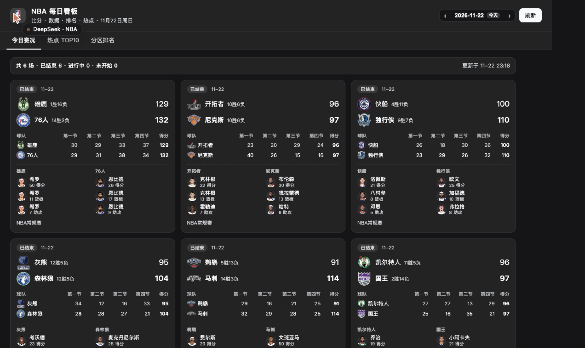
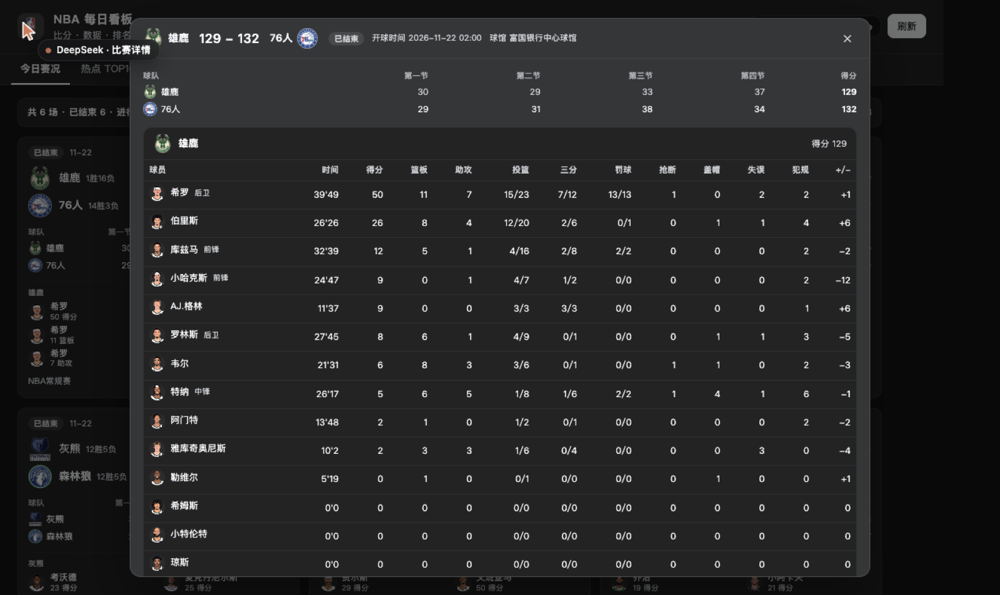
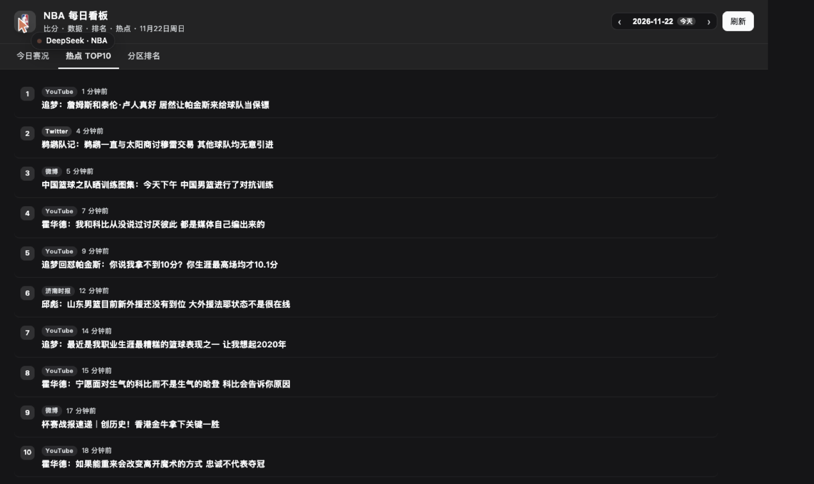
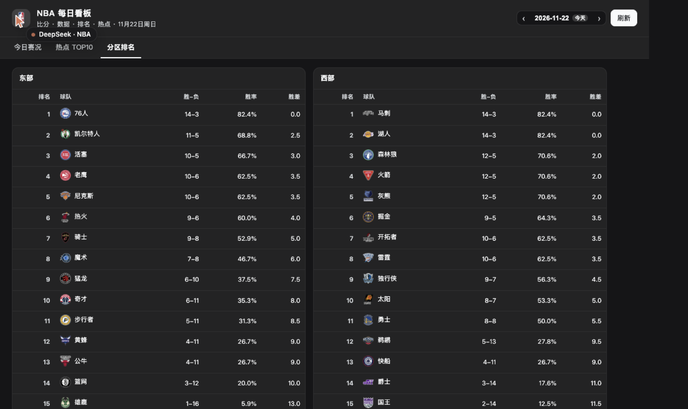

# NBA 每日看板

DeepSeek Harness 的侧边栏面板插件：每天的比赛比分、单场技术统计、东西部排名，以及热点新闻 TOP10。
所有内容均为**简体中文**，数据来自腾讯体育 NBA 与直播吧 NBA。



## 功能

### 每日赛况
- 按日期翻页（前一天 / 后一天 / 日期选择器，一键回到今天）
- 每场显示双方队徽、中文队名、实时/最终比分、赛季战绩（如 `14胜3负`）
- 逐节得分表（第一节–第四节，含加时），胜方高亮
- **每队三项最高**：该队本场得分王、篮板王、助攻王，带球员头像
- 进行中的比赛每 30 秒自动刷新，卡片上有实时状态标签（如 `Q3 4:21`）

### 技术统计（点开任意一场比赛）
- 球馆、上座、开球时间
- 两队各 12 列中文表头的完整球员数据：时间、得分、篮板、助攻、投篮、三分、罚球、抢断、盖帽、失误、犯规、+/-
- 队伍汇总行与命中率



### 热点 TOP10
直播吧 NBA 滚动新闻，按发布时间排序，标注来源与相对时间，可点击跳转原文。



### 分区排名
东部与西部各 15 队，含排名、胜负、胜率、胜差。
列会根据数据源实际提供的字段自动显示或隐藏——腾讯排名接口只有这几项，所以不会出现一排空列。



## 安装

```bash
# 用 GitHub 上的发布包（市场收录后可直接从 DSH 市场点安装）
dsh plugin --profile desktop add https://github.com/Hujing0527/dsh-nba-board/releases/latest/download/dsh-nba-board.tgz

# 或从本地仓库目录安装
dsh plugin --profile desktop add /path/to/dsh-nba-board
```

装好后**刷新页面**，侧边栏会出现一个 NBA 标志的图标，点它打开看板。

## 数据从哪来

| 内容 | 来源 | 缓存 |
| --- | --- | --- |
| 比分 | `app.sports.qq.com/m/match/list` | 进行中 20 秒 / 未开赛 60 秒 / 其余 10 分钟 |
| 技术统计 | `matchweb.sports.qq.com/kbs/matchStat` | 已结束 3 小时 / 进行中 20 秒 |
| 球馆 | `matchweb.sports.qq.com/kbs/matchDetail` | 同上 |
| 排名 | `matchweb.sports.qq.com/team/rank` | 15 分钟 |
| 队名与队徽 | `matchweb.sports.qq.com/match/api/v2/team/groups` | 6 小时 |
| 新闻 | `news.zhibo8.cc/nba/more.htm` | 3 分钟 |

数据由插件的宿主侧抓取并缓存，页面本身不直接请求外网——所以没有跨域问题，且面板和 Agent 工具共用同一份缓存。

## Agent 工具

插件同时注册了一个 `nba_board` 工具，可以直接在对话里问：

> 昨天 NBA 有什么比赛？
> 给我 2026-11-21 的日报
> 现在东西部排名怎么样？

支持 `scoreboard` / `game` / `news` / `standings` / `brief` 五种动作。

## 已知限制

- **日期按北京时间划分**，与 NBA 官方（美国当地时间）的"比赛日"可能差一天。凌晨的比赛会算在北京时间的当天。
- **新闻是发布时间倒序，不是算法筛选的"热点"**。直播吧没有提供热度排序接口。
- 腾讯排名接口只提供排名/胜负/胜率/胜差，没有连胜场次、近十场、场均得失分，因此这些列不显示。
- 腾讯不提供上座人数与裁判信息，技术统计弹层里这两项保持隐藏。
- 休赛期或没有比赛的日子会显示"这一天没有比赛"的空状态，这是正常现象。
- 两个数据源都没有公开 API 文档，页面改版会导致解析失败。失效时面板会显示明确的错误提示与重试按钮，而不是白屏。

## 许可

MIT
