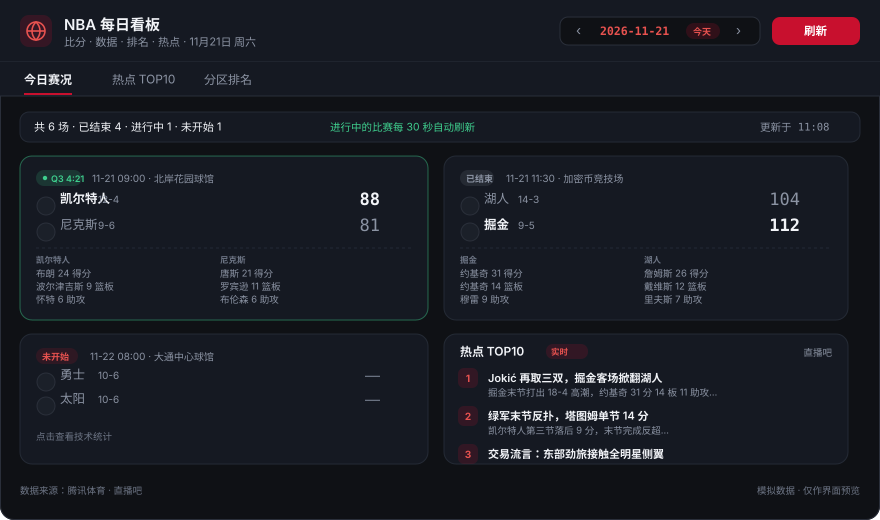

# NBA 每日看板

把每天 NBA 的比分、球员数据、东西部排名和热点新闻放在一个页面里，侧边栏一键打开。

## 能做什么

### 今日赛况

- **按日期翻页**：‹ › 逐日切换，点中间日期可直接跳到任意一天，不在今天时会出现「今天」按钮一键回到今天。
- **每张比赛卡**：客/主队徽标、缩写、当前战绩、比分；已结束的场次标出胜方加粗；进行中的场次有绿色高亮和呼吸点。
- **球队排名**：队名旁的小徽标显示该队的分区排名，形如 `东3`（东部第 3）或 `西5`（西部第 5），鼠标悬停显示「东部第 3 名」。排名与战绩同时可见，不用切到「分区排名」页；技术统计弹层里两队也带同样的排名徽标。排名来自腾讯排名接口，随每天比赛结果更新（缓存 15 分钟）。
- **实时比分（进行中）**：腾讯的 `liveType` 不能单独判定状态——`3` 同时用于「未开始」和「进行中」，真正区分要看 `quarter`（`第N节` / `加时` / `中场休息` / `节间` / `进行中`）。插件以 `quarter` 为准识别进行中的比赛，**实时显示当前比分、节次与剩余时间、逐节得分和三项领先者**（这些都随比赛推进更新）；只有 `quarter` 明确为 `未开始 / 比赛待定 / 空` 才显示「未开始」占位。刚跳球 0-0 的场次也会正确识别为进行中。
- **真实队徽**：所有球队位置都显示腾讯体育的官方队徽（不是文字缩写或占位图形），侧边栏入口、面板头部与空状态用的是 NBA 联赛标志；球员榜与 box score 里带头像，加载失败时自动退回简洁占位，不会出现破图。
- **分节比分**：逐节得分（第一节–第四节，含加时），最后一列是总分。进行中的比赛逐节得分随比赛实时增长。
- **每队三项最高**：卡片上左右各一列，分别是客队与主队的「最高得分 / 最多篮板 / 最多助攻」，带球员头像与数值。同一个球员可能同时占据其中两项（这很常见），不会去重。未开赛或某项数据缺失时该行不显示，不会留空占位；进行中的比赛这三项也实时更新。
- **自动刷新**：只要当天有进行中的比赛，每 15 秒自动拉一次最新比分；打开的技术统计弹层同样每 15 秒刷新。全部结束或还没开始时不会空转。
- **看直播**：每张卡片头部有「看直播」按钮，点开是**弹窗卡片**（不跳浏览器），列出去哪儿看这场球。点任一平台行即在新标签页打开并**自动收起卡片**。卡片按「能否直达本场」分组，并给每个平台标出**免费 / 需会员**：

  | 平台 | 直达 | 费用 | 说明 |
  | --- | --- | --- | --- |
  | **腾讯体育** | ✅ 本场直达 | **按场次判定** | 用 matchId 拼出本场页面。腾讯每天会放几场免费，逐场读 `isPay` 判断：免费场标「免费」，其余标「需会员」 |
  | **央视 CCTV5** | ❌ 频道页 | **免费** | 每周 2–4 场焦点战，完全免费 |
  | **央视 CCTV5+** | ❌ 频道页 | **免费** | 体育赛事频道，部分 NBA 场次，完全免费 |
  | **央视频** | ❌ 首页 | **免费** | 央视官方 App/网页，同步 CCTV5 信号，1080P 免费 |
  | **咪咕视频** | ❌ 搜索页 | 需会员 | 国内全场次，需在平台内自行搜索 NBA（多数场次需会员） |
  | **NBA 官方** | ❌ 观看页 | **免费场次** | 每周一场免费直播 + 胶着末节 CrunchTime 免费，需注册免费 NBA ID |

  卡片顶部有「只看免费」筛选，一键滤出当下的免费渠道（含腾讯当天的免费场次，数量随日期变化）。只有腾讯能按具体比赛直达，其余都只能到频道页/搜索页，卡片上标「无直达」并写明原因。免费与付费徽标始终显示，避免点进去才发现要付费。腾讯的免费场次是逐场判定的：插件按天读取每场的 `isPay`（`'0'`=免费），拿不到时标「费用未知」而不是猜。是否免费、是否有版权最终以平台页面为准。
- **技术统计弹层**：点任意一张比赛卡，弹出该场的完整 box score（两队球员逐行数据 + 球队总计），进行中的比赛也能看到实时的比分、节次、逐节得分与球员数据；按 Esc 或点遮罩关闭。

### 热点 TOP10

按直播吧 NBA 滚动新闻的时间顺序编号列出 1–10 条，包含标题、来源标签（直播吧 / Twitter / YouTube / 微博 / 露天看台…）和相对时间；点标题在新标签页打开原文。

### 分区排名

东西部两张表，列出排名、球队、胜负、胜率与胜差，按排名排序。腾讯排名接口只提供这五项，遇到有额外列的数据源时表格会自动多出对应列（连续战绩、近十场、场均得失分），换源不需要改代码。

## 数据从哪来

**全部为简体中文**，没有英文内容，也不需要 API Key：

| 用途 | 来源 |
| --- | --- |
| 每日比分 / 分节 / 领先者 | 腾讯体育 `app.sports.qq.com/m/match/list?columnId=100000&date=YYYY-MM-DD&dateNum=1&flag=2` |
| 单场技术统计 | 腾讯体育 `matchweb.sports.qq.com/kbs/matchStat?mid=<matchId>` |
| 球馆 | 腾讯体育 `matchweb.sports.qq.com/kbs/matchDetail?mid=<matchId>` |
| 东西部排名 | 腾讯体育 `matchweb.sports.qq.com/team/rank?competitionId=100000` |
| 球队中文名与队徽 | 腾讯体育 `matchweb.sports.qq.com/match/api/v2/team/groups?competitionId=100000` |
| 热点新闻 TOP10 | 直播吧 NBA 滚动新闻 `news.zhibo8.cc/nba/more.htm` |

比分/技术统计/排名/队徽/球馆来自腾讯体育的公开 JSON 接口（无需签名），新闻来自直播吧页面（腾讯没有可用的 NBA 新闻接口，其 `feeds/list` 返回的是全站社区热帖而非 NBA 新闻）。所有请求都在主进程一侧发出，经本地 `/nba-board/api/rpc` 路由转发，页面本身不直连外网，因此不受浏览器跨域限制；同一份缓存同时服务页面和 Agent 工具。缓存策略：

- 比分：有进行中的比赛 20 秒（比分列表原始请求 15 秒），全部未开始 60 秒，已结束 10 分钟；
- 单场技术统计：已结束 3 小时，否则 15–30 秒（比分卡 15 秒、技术统计弹层 30 秒）；
- 新闻 3 分钟；排名 15 分钟；球队名单与队徽 6 小时。

缓存链刻意比客户端 15 秒轮询更短，保证进行中的比分不会被旧缓存「冻住」。

## 给 Agent 用的工具

装好之后会多一个 `nba_board` 工具，可以直接在对话里问「今天有哪些比赛」「勇士昨天赢了没有」「来一份今天的简报」：

| action | 说明 |
| --- | --- |
| `scoreboard` | 某天全部比赛（`date` 可选，`YYYY-MM-DD` 或 `YYYYMMDD`，缺省今天） |
| `game` | 单场完整技术统计（`eventId` 必填，取自 `scoreboard` 的 `games[].id`，即腾讯 matchId，形如 `100000:10022600043`） |
| `news` | 热点新闻（`limit` 1–50，默认 10） |
| `standings` | 东西部排名 |
| `brief` | 一天的纯文本简报：比分 + 新闻 TOP10 + 分区前八 |

## 说明与边界

- 日期按**北京时间**分日（腾讯返回的时间戳就是北京时间），所以北京时间上午结束的比赛归在当天，而不是美国日期。
- 腾讯比分接口在没有比赛的日子不返回空列表，而是返回「下一个有比赛的日子」；插件会核对返回的日期键，对不上就当这一天没有比赛，不会串日。
- 新闻源按发布时间倒序，不是人工排序的「热度榜」；`TOP10` 指时间序列里的前 10 条。
- 无比赛的日子（休赛期、全明星周末）会显示「这一天没有比赛」，属正常结果。
- 腾讯接口结构若改版或开始要求签名，面板会显示错误提示而不是空白页。
- 腾讯不提供上座人数与裁判名单，详情页这两项保持隐藏；球馆名来自单场详情接口。
- 数据版权归腾讯体育 / 直播吧 / NBA 所有，本插件只做只读聚合展示。
